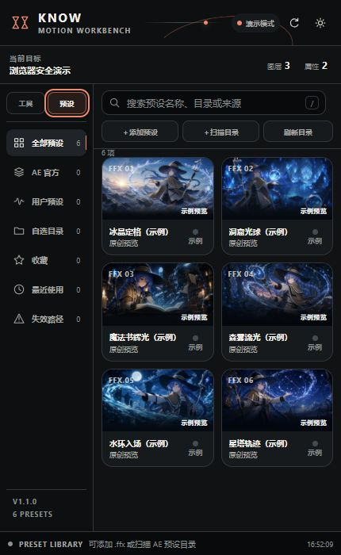
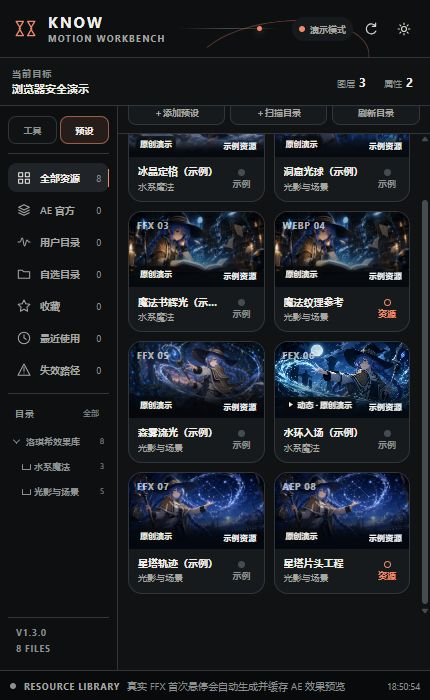
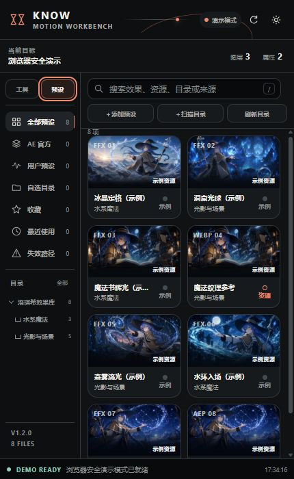
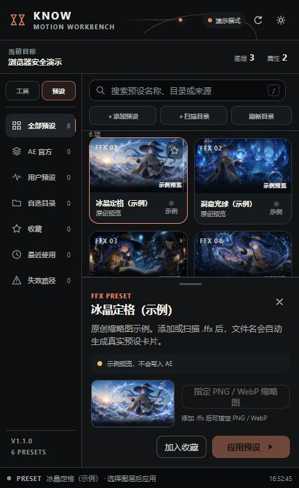
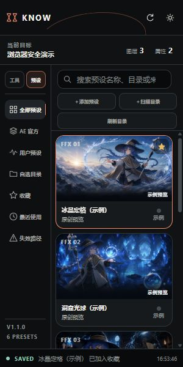

<p align="center">
  <strong>English</strong> · <a href="README_CN.md">中文</a>
</p>

<h1 align="center">KNOW Motion Workbench</h1>

<p align="center">
  A dockable <b>After Effects</b> CEP visual toolbox with a recursive effect-library index and
  <b>AE-rendered hover previews</b> — real <code>.ffx</code> effects, rendered by After Effects itself and cached as MP4s.
</p>

<p align="center">
  <a href="https://github.com/kevildurant/KNOWMotionWorkbench/releases">
    
  </a>
  <a href="LICENSE">
    
  </a>
  <a href="https://github.com/kevildurant/KNOWMotionWorkbench/releases">
    
  </a>
  
  
  
</p>

---

## About

**KNOW Motion Workbench** is an After Effects extension panel that turns your scattered preset libraries into a browsable, searchable, *previewable* toolbox.

V1.3.1 ships **12 executable tools** and a complete effect resource library. It recursively walks the After Effects official, user, and your own chosen preset folders — preserving the full folder hierarchy — generates an effect card from every `.ffx` filename, and binds same-name PNG/WebP/JPG/GIF/MP4/WebM/MOV files as static or animated previews.

The standout feature: an FFX with no video attached gets its preview **generated for real**. Hover a card for 650 ms and the panel applies the preset to a bundled 640×360 video backdrop, lets After Effects render the result, encodes it to an H.264 MP4 with FFmpeg, and caches it atomically. No faked thumbnails — the preview you see is the actual effect, rendered by AE itself.

Images, videos, scripts, AE projects, and MOGRTs that aren't bound to a preset are shown as read-only resource cards.

## Screenshots

<p align="center">
  
  
  
  
  
</p>

*From left to right: the effect card grid · a real AE-rendered hover preview · the resource library · the details drawer · the responsive narrow layout.*

## Features

- **12 tool actions** for After Effects — each wrapped in an Undo Group, so every operation is one `Ctrl+Z` away.
- **Recursive effect-library index** — keeps the folder hierarchy of AE official, user, and custom preset directories; honors `folder.json` metadata (`name`, `cover`, `category`, `order`).
- **Real FFX hover previews** — first hover (650 ms) applies the preset to a bundled video backdrop inside AE, renders it, and encodes a cacheable MP4; already-present video previews play directly without re-rendering.
- **Same-name media binding** — `水波纹.ffx` + `水波纹.mp4` in the same folder automatically pairs; video takes priority over a still image.
- **Honest preview labels** — every card states its real preview source (same-name media, manual thumbnail, folder cover, the resource itself, original demo, or placeholder) — a placeholder is never disguised as a real effect.
- **Resource library** — images, videos, JSX/JSXBIN, AEP/AET, and MOGRT files appear as read-only resource cards; they are never executed.
- **Safe by design** — validates the active comp / selected layer before acting, never deletes layers, never saves or closes the project, and never touches the network.
- **Seamless upgrades** — indexes auto-migrate from V1.1/V1.2, so existing root folders don't need to be re-added.

## Requirements

| Dependency | Purpose | Notes |
|---|---|---|
| **After Effects** | Host app | Tested against AE 2025 |
| **CEP 11+ runtime** | Extension host | Modern AE versions ship it |
| **FFmpeg** | Encode AE output to MP4 | Required only for auto-generated hover previews. Auto-detected from `PATH`, `FFMPEG_PATH`, the WinGet install location, or `%ProgramFiles%\ffmpeg\bin\` |

The panel does **not** require an internet connection — all scanning, rendering, and caching happens locally.

## Installation

> The full Chinese guide lives in [`docs/INSTALL_CN.md`](docs/INSTALL_CN.md). For Release downloads, grab `KNOWMotionWorkbench_vX.Y.Z.zip` from the [Releases page](https://github.com/kevildurant/KNOWMotionWorkbench/releases).

1. **Download & unzip** the package from [Releases](https://github.com/kevildurant/KNOWMotionWorkbench/releases).
2. **Copy** the `KNOWMotionWorkbench` folder into your CEP extensions directory:

   ```
   C:\Users\<you>\AppData\Roaming\Adobe\CEP\extensions\
   ```

3. **Enable unsigned extensions** for development (see `docs/INSTALL_CN.md` for `PlayerDebugMode`), then restart After Effects.
4. Open the panel via **Window → Extensions (Legacy) → KNOW Motion Workbench**.
5. In **After Effects → Preferences → Scripts & Expressions**, enable *"Allow Scripts to Write Files and Access Network"* so the panel can scan local directories.

## Quick test

1. Create a comp and a shape layer with two keyframes on **Position**; select the *Position* property.
2. Open the **Elastic Bounce** tool and run it — the position should get a bouncing expression, playable and undoable with a single `Ctrl+Z`.
3. Switch to **Presets** and hover a real `.ffx` card for 650 ms to watch an actual AE-rendered preview generate.
4. Scan a folder tree and confirm the full hierarchy appears with an effect card per `.ffx`.
5. Shrink the panel — cards collapse to a single column with no horizontal overflow.

## Development

Run the static checks locally:

```powershell
npm test
```

The suite validates the CEP manifest, HTML/CSS/JS integrity, the 12 tool-action mapping, ES3-compatibility of the ExtendScript host, recursive `.ffx` scanning, preview-cache rules, and more (currently **72/72 checks pass**). See [`docs/VALIDATION.md`](docs/VALIDATION.md) for the full validation record.

Opening `index.html` directly in a browser enters **demo mode** — the tool pages, folder tree, preset cards, and resource cards are fully browsable, but local-directory dialogs and `applyPreset()` only work inside CEP/After Effects.

## Project structure

```
KNOWMotionWorkbench/
├── CSXS/manifest.xml        # CEP extension manifest
├── index.html               # Panel UI shell
├── css/panel.css            # Panel styles
├── js/
│   ├── app.js               # Panel application logic
│   ├── catalog.js           # Tool catalog
│   ├── host-bridge.js       # CSInterface bridge to the ExtendScript host
│   ├── preset-store.js      # Directory scan, preset index, persistence
│   └── preview-renderer.js  # AE render tasks, FFmpeg probe, MP4 cache
├── jsx/host.jsx             # After Effects ExtendScript layer
├── assets/
│   ├── preset-previews/     # Original Roxy-themed preview images + dynamic demo
│   ├── preview-source/      # Bundled AE-render video backdrop
│   └── screenshots/         # README screenshots
├── docs/
│   ├── INSTALL_CN.md        # Installation & verification guide (中文)
│   └── VALIDATION.md        # Validation record
└── tests/static-check.mjs   # Static verification suite
```

## Safety guarantees

- The active composition, selected layer, or selected property is validated **before** every action.
- Every operation runs inside one **Undo Group** — a single undo reverts it.
- Layers are never deleted; projects are never saved or closed; nothing touches the network.
- Expression tools may replace an existing expression on the selected property, but never delete keyframes.
- `.ffx` files are never copied or rewritten — the index stores paths, favorites, recents, and thumbnail mappings only.
- Rendered previews use temporary comps and render-queue items that are fully cleaned up afterwards; your existing render queue is restored to its prior state.
- MP4 caches live in `%APPDATA%\KNOWMotionWorkbench\preview-cache` and are invalidated when the source `.ffx` changes.

## Known limitations

- Unsigned CEP extensions require dev mode (or signing) to load.
- "Center Content Anchor" only handles 2D text/shape layers with unseparated position and no keyframes on position or anchor; complex parents, 3D, or keyframed scenarios are safely skipped.
- Browser demo mode validates the UI only — it is not a substitute for real AE host testing.
- Some presets (text, camera, audio, third-party plugins, specific layer types, multi-layer structures) may fail to render a representative preview; provide a same-name video for those.

## Contributing

Bug reports, feature ideas, and pull requests are welcome. Before opening a PR, please make sure `npm test` passes locally.

## License

[MIT](LICENSE) © 2026 kevildurant
